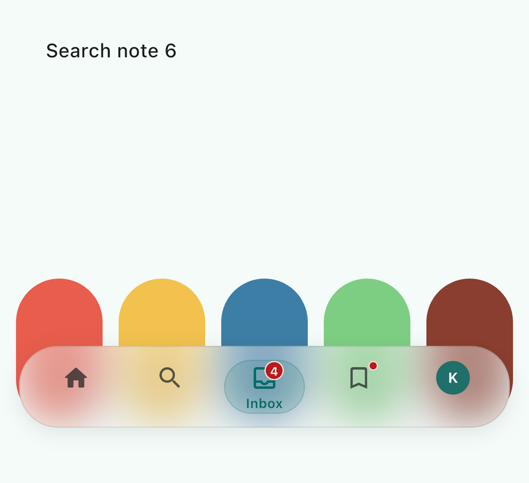
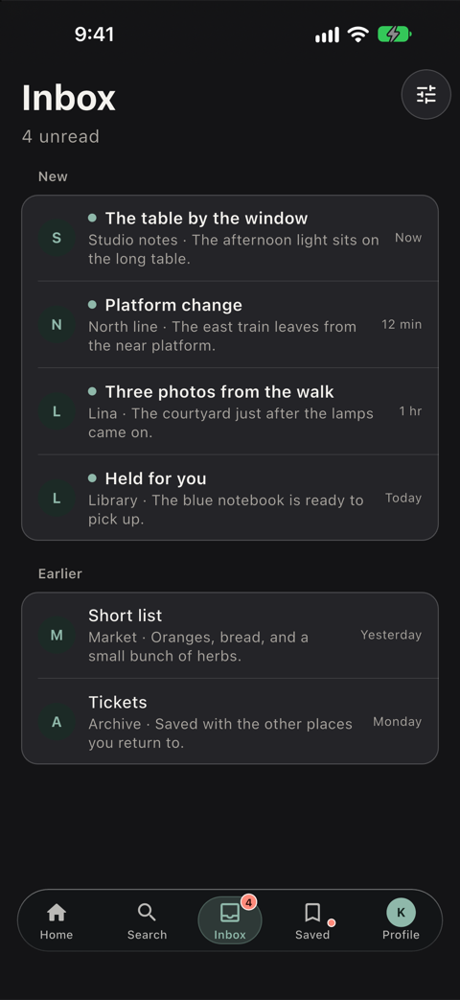
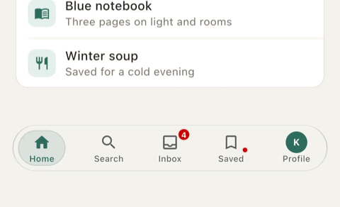

# liquid_glass_bottom_navigator

A floating, rounded, translucent bottom navigation bar for Flutter. The selected item is marked by a capsule that moves with a spring. An optional morphing mode stretches that capsule while it travels, then lets it settle.

The bar is controlled by your widget. It does not own a navigation stack, a router, or an application state object.

**Status:** the navigation bar, glass surface, motion, badges, haptics, themes, and accessibility behavior in this README are implemented. This package does not simulate optical glass refraction.

## Preview

These frames are from the example on an iPhone 18 Pro Max simulator. The colored shapes are page content behind one backdrop blur. The GIF is the morphing indicator traveling from Home to Inbox and back.






## Install

Requires Flutter `>=3.47.0` and Dart `^3.13.4`. The spring uses `SpringDescription.withDurationAndBounce`. That constraint was not lowered, because an older SDK was not available to validate here.

```yaml
dependencies:
  liquid_glass_bottom_navigator: ^1.1.0
```

A local checkout can still use a path dependency:

```yaml
dependencies:
  liquid_glass_bottom_navigator:
    path: ../liquid_glass_bottom_navigator
```

```dart
import 'package:liquid_glass_bottom_navigator/liquid_glass_bottom_navigator.dart';
```

The library file is named after the package. The public widget is `LiquidGlassNavigationBar`.

## Quick start

```dart
int index = 0;

LiquidGlassNavigationBar(
  currentIndex: index,
  onIndexChanged: (value) => setState(() => index = value),
  items: const [
    LiquidGlassNavigationItem(icon: Icons.home_rounded, label: 'Home'),
    LiquidGlassNavigationItem(icon: Icons.search_rounded, label: 'Search'),
    LiquidGlassNavigationItem(icon: Icons.person_outline_rounded, label: 'Profile'),
  ],
)
```

Place the bar over content, usually in a `Stack`, and leave space at the bottom of scrollables. Give the parent a bounded width. The default width is that parent width after the bar's margin. It does not force a full-screen width.

`currentIndex` is the selection. `onIndexChanged` fires when a tap, or a completed drag, requests a different item. Programmatic index changes animate the indicator and do not play haptics. Tapping the already selected item does nothing. Building the bar does not call `onIndexChanged`.

## Drag to select

Dragging is off unless you set `enableDragSelection: true`. Existing callers keep tap-only behavior.

```dart
LiquidGlassNavigationBar(
  enableDragSelection: true,
  currentIndex: index,
  onIndexChanged: (value) => setState(() => index = value),
  items: items,
)
```

Press the selected destination and drag horizontally. The capsule follows the finger and keeps the grab offset, so it does not jump. The bar does not call `onIndexChanged` while the finger is down. On release, the destination under the finger is the only candidate. A gap, the padding, or a point outside every slot is not a selection: the capsule springs back and the callback is not used. Releasing on the already selected destination does the same.

A different destination calls `onIndexChanged` once. The parent decides whether `currentIndex` changes. If it does, the capsule springs from the drag preview into that slot. If the parent keeps the old index, or changes it later, the capsule follows `currentIndex`. The package does not store a second selection.

The drag starts only on the selected slot, after the touch slop, so a tap still selects. A vertical move is left to the surrounding scroll view. RTL uses the laid-out slot rectangles. `morphingPill` stretches slightly with the drag. When the finger slows or reverses, that stretch eases back to a plain pill before it points the other way. `slidingPill`, reduced motion, and `LiquidGlassMotion.none()` follow the finger without that stretch. Haptics play once when a drag requests a new index, and they stay silent for the preview, a snap-back, and a parent-driven index change. Keyboard and screen-reader activation do not require dragging.

An empty `items` list draws the glass surface with no destinations. An index outside `0 .. items.length - 1` selects nothing; taps on real items still report a new index. An invalid index does not throw. Changing the number of items snaps the indicator onto `currentIndex`. A reorder that keeps the same length does not replay motion unless the index changes.

`respectSafeArea` defaults to true and adds the bottom view padding to the margin. Set it to false when the parent already places the bar inside the safe area. `semanticsLabel` names the tab bar. It does not replace item names.

## Items

An item needs an icon or a child. A label by itself is invalid and fails an assertion in debug mode. A child replaces the icon and is not recolored. The label stays optional and can sit beside either an icon or a child.

```dart
const LiquidGlassNavigationItem(icon: Icons.home_rounded)

const LiquidGlassNavigationItem(icon: Icons.search_rounded, label: 'Search')

LiquidGlassNavigationItem(
  child: CircleAvatar(radius: 14, backgroundImage: avatarProvider),
  semanticLabel: 'Profile',
)

const LiquidGlassNavigationItem(
  icon: Icons.inbox_outlined,
  label: 'Inbox',
  badge: LiquidGlassBadge.count(12),
)
```

Pass any widget the app can already build, including an SVG from a package the app depends on. This package does not depend on an icon or SVG library.

If a custom child has no label, set `semanticLabel`. Otherwise the spoken name falls back to `Tab N`.

A child that wins the gesture arena, such as its own button, can block the item tap.

## Label modes

`LiquidGlassLabelMode`:

- `hidden` hides every label and does not reserve a label band. Every icon is centered in the glass, and the capsule is centered on the selected icon. The capsule width follows the icon and stays a horizontal pill. Screen readers still hear the destination name.
- `always` shows every label that was provided. Each icon and label is centered as one group, so the icons share one vertical line. The selected capsule wraps that icon and the whole label.
- `selected` shows a label only on the selected item. Unselected icons are centered in the glass. The selected icon moves up to make room for its label, and that icon-plus-label group stays centered in the capsule. The move follows the selection spring. A drag preview does not label a destination until the parent adopts it.

Items without labels are valid in every mode. All three modes share the bar size. They do not share one icon line: `hidden` centers icons, `always` centers icon-plus-label groups, and `selected` does both depending on the item. `hidden` wraps the icon, then widens the capsule around that icon when the result would be round. The bar height does not jump when the selection or the label mode changes. On the first and last destinations, the capsule's distance to the glass matches on the top, the bottom, and the outer side when the slot can hold that inset. A narrow slot or large text keeps the capsule inside the glass, centered on the visible content, instead of forcing the gap.

## Layout and glass

`LiquidGlassNavigationStyle` controls size and material:

- `width`, `minWidth`, and `maxWidth` (default max width is 520; a narrower parent uses the space left after `margin`; use `double.infinity` for the full parent)
- `height` as the minimum glass height, excluding margin
- `maxHeight` and `expandForTextScale` for large text
- `margin`, `padding`, `itemPadding`, and `itemSpacing` as `EdgeInsetsGeometry` where a direction matters
- `itemLayout`: `equal` slots (default) or `intrinsic` widths. Intrinsic rows that do not fit fall back to equal slots. The indicator uses the measured slot, not a guessed width
- `borderRadius`, `indicatorInset` (horizontal and vertical capsule margins; each axis uses its smaller side), `indicatorRadius`
- `iconSize`, label styles, and `labelSpacing`
- `blurSigma` (zero disables the blur), `borderWidth`
- `elevation` (default 0, no drop shadow), with optional `shadowBlurRadius` and `shadowOffset`
- `minTouchTarget` (default 48). The slot honors it when the bar is tall and wide enough
- `backgroundColor`, `backgroundOpacity`, `borderColor`, `indicatorColor`, `selectedForeground`, and `unselectedForeground` override the resolved theme. Unset fields keep the theme color. An item `foregroundColor` still wins over the style foreground
- `respectSafeArea` adds the bottom view padding under the glass. The default is true
- `badgeOffset` and `badgeMinSize`. A count sits above the icon's trailing corner and a dot sits below it. Positive badge x moves further outward, so it flips in RTL. Positive y moves the badge down

There is no separate item border radius. The bar radius and the indicator radius are the corner controls, so badges are not clipped by an extra item shape.

`LiquidGlassNavigationTheme` holds the colors. `LiquidGlassNavigationTheme.adaptive()` keeps a neutral glass tint and takes the accent, indicator, and unselected foreground from `ThemeData.brightness` and `ColorScheme`. `LiquidGlassNavigationTheme.light` and `.dark` stay fixed. Pass any explicit theme to ignore the ambient colors. A style color set by the caller is applied after that resolution and is not replaced by the adaptive theme.

The glass is one clipped `BackdropFilter`, a neutral tint, and a soft rim that is lighter along the top edge. The default elevation is 0, so there is no drop shadow unless you set one. There is no second blur and no refraction shader. `BackdropFilter` softens the pixels behind the bar. It does not bend them. Set `blurSigma` to `0` for a flat tint when blur is too costly or unavailable. Web and older GPUs vary in how well `BackdropFilter` performs. Impeller can blur, and it is still not free.

## Motion

`LiquidGlassMotion.spring()` is the default: about 480ms perceptual duration, a small bounce, and a moderate stretch. Also available: `snappy()`, `gentle()`, and `none()`.

`duration` and `bounce` feed `SpringDescription.withDurationAndBounce`, which is how stiffness and damping are chosen. There is no second pair of raw stiffness knobs. `morphIntensity` (`0` to `1`) scales the liquid stretch used by `LiquidGlassIndicatorStyle.morphingPill`. While that indicator travels, its leading end stays round and its trailing end narrows, then it settles back into a pill. `LiquidGlassIndicatorStyle.slidingPill` slides and resizes without that stretch.

`respectReducedMotion` defaults to true. `MediaQueryData.disableAnimations` then skips the spring and the stretch and moves the capsule immediately. `LiquidGlassMotion.none()` does the same even when reduced motion is off.

One `AnimationController` drives the capsule. Item widgets are not rebuilt on each tick. Changing the number of items snaps the capsule to the current index instead of continuing a stale flight. Rapid taps retarget from the in-flight rectangle. A drag uses the same spring when the finger lifts. Pointer moves repaint the row and do not rebuild the items.

## Haptics and badges

`hapticsEnabled` and `haptic` (`selection`, `light`, or `medium`) use Flutter's `HapticFeedback`. Feedback plays once per tap or completed drag that requests a new index. It does not play while a finger is moving, when the capsule returns to the current item, or for a parent-driven index change. Devices and system settings decide whether anything is felt.

`LiquidGlassBadge.dot()` draws a dot. `LiquidGlassBadge.count(12)` draws a number, and counts above `maxCount` (default 99) render as `99+`. A count of `0` is hidden. `maxCount` must be at least 1. `LiquidGlassBadge.child` overlays any widget. `LiquidGlassBadge.custom` is the same constructor. Badges are painted outside the item's layout size. The spoken label includes "new notification" or "N notifications", or the custom badge's own `semanticLabel`. That phrase is part of the item label, not a second button.

## Accessibility, text scale, and RTL

Each destination is a semantic tab inside a tab bar. Pass `semanticsLabel` on the bar to name the group. The selected tab is exposed as selected, and the name comes from the item `semanticLabel`, then `label`, then `Tab N`. Selection is also visible as the capsule and a heavier label weight, not only as color.

Tab moves focus between destinations. Enter and Space activate the focused destination. A focused item draws a hairline in its foreground color. Screen-reader activation stays on the tab semantics node, so keyboard focus does not add a second button.

`height` is a minimum. With `expandForTextScale` the bar can grow for larger text up to `maxHeight`. Set `expandForTextScale` to false to lock the height. Item slots request a 48 logical pixel minimum height when the bar is at least that tall.

Margins, padding, badge placement, and item order follow `Directionality`.

## Example

From `example/`:

```bash
flutter pub get
flutter run
```

The example is a five-page gallery with content scrolling behind the bar. Appearance can switch label mode, theme, blur, size, radius, margin, motion, haptics, drag selection, reduced motion, RTL, equal or intrinsic slots, safe area, and compact width. Drag selection starts on. Turn it off from Appearance. The page says: "Hold and drag the selected tab to switch destinations."

The preview images above are simulator captures, not drawings. Widget goldens still use `blurSigma: 0`, because backdrop sampling is not stable across test runs.

## Tests

From the package root:

```bash
flutter pub get
flutter analyze
flutter test
```

Golden files live in `test/goldens/`. They use blur sigma 0 so the images do not depend on backdrop sampling. Regenerate them with `flutter test --update-goldens` on the platform you intend to compare. Goldens produced on one operating system can differ on another; the test harness allows up to 2% pixel variance for that reason.

## Performance

The bar keeps a single animation controller and a single backdrop blur. The blur is clipped to the bar and is not wrapped in its own repaint boundary, so it can sample the page behind it. The item row is the repaint boundary inside that filter. The capsule is painted by the row's render object, so indicator frames, including a drag, do not rebuild the items.

Blur cost depends on the device, the sigma, and how much of the screen the bar covers. Prefer a modest sigma. Do not stack more `BackdropFilter`s on top of this one.

This repository does not include measured frame timings, and iPhone performance has not been verified. The example can record `FrameTiming` on macOS. The iOS simulator cannot build profile mode. To capture a physical iPhone, connect the device and run the same entry point only when you intend to install the example:

```bash
cd example
flutter run --profile -d macos -t lib/profile_main.dart
```

Replace `macos` with the physical iPhone device id for that follow-up. See `example/README.md`.

## Versioning

Version `1.1.0` adds opt-in drag selection and stays compatible with `1.0.0`. The license is BSD 3-Clause. See [LICENSE](LICENSE). Issues: https://github.com/K-Almahamid/liquid_glass_bottom_navigator/issues. See [CONTRIBUTING.md](CONTRIBUTING.md).

Source: https://github.com/K-Almahamid/liquid_glass_bottom_navigator
